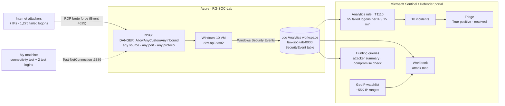
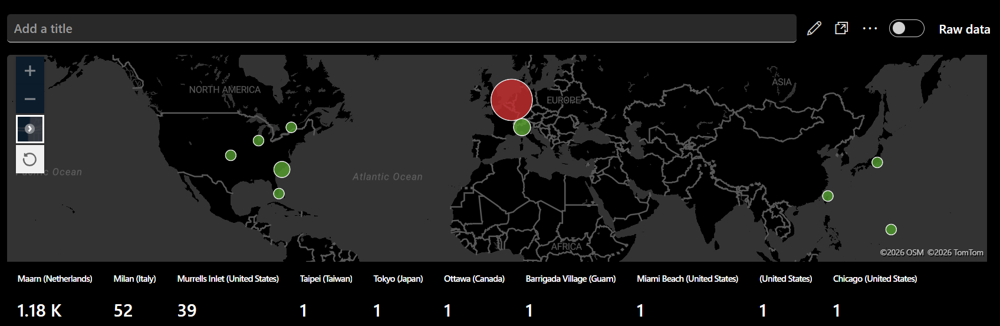
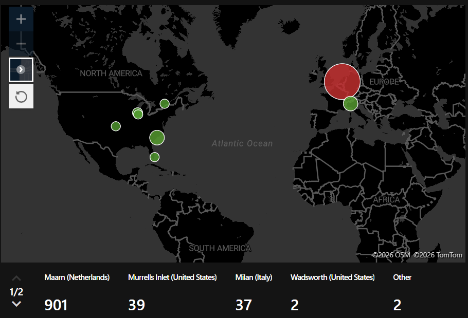
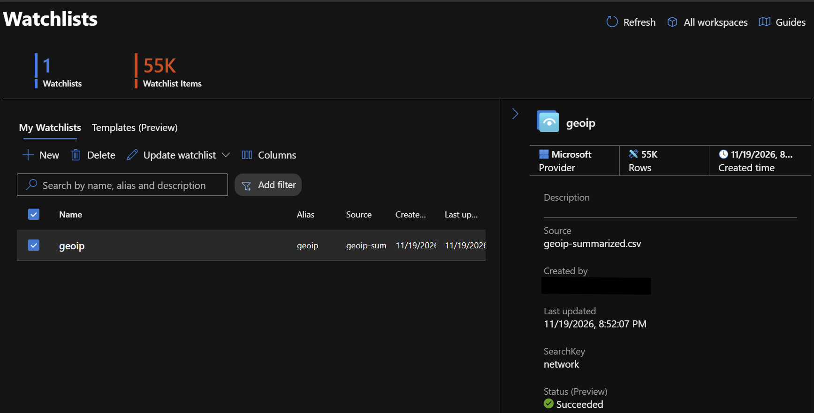
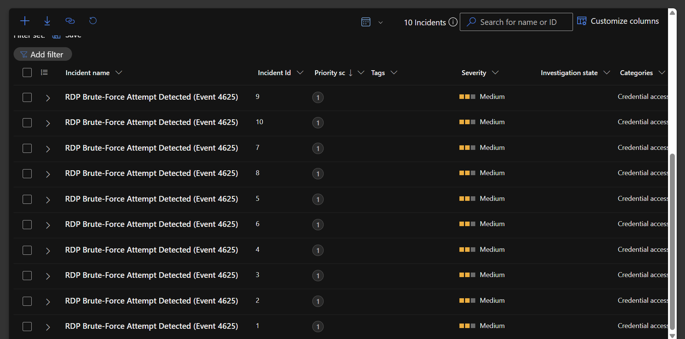
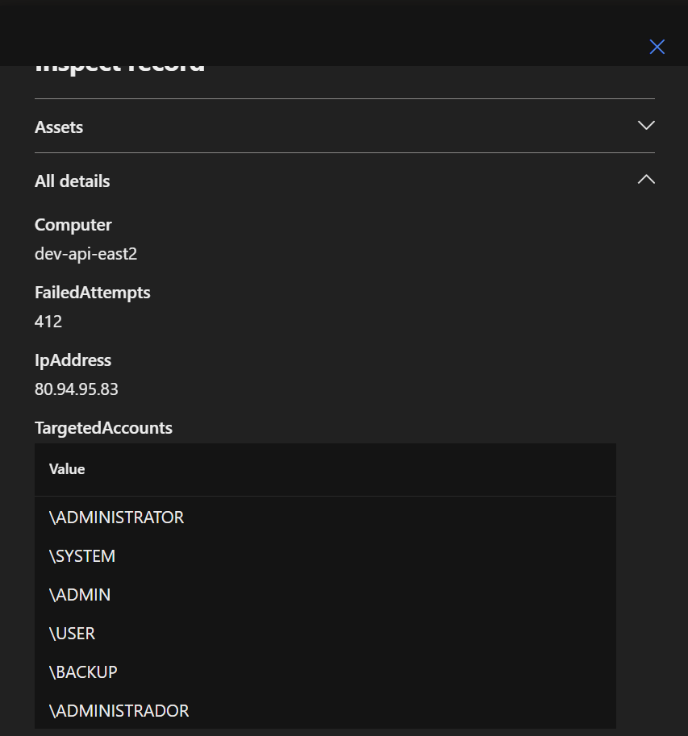
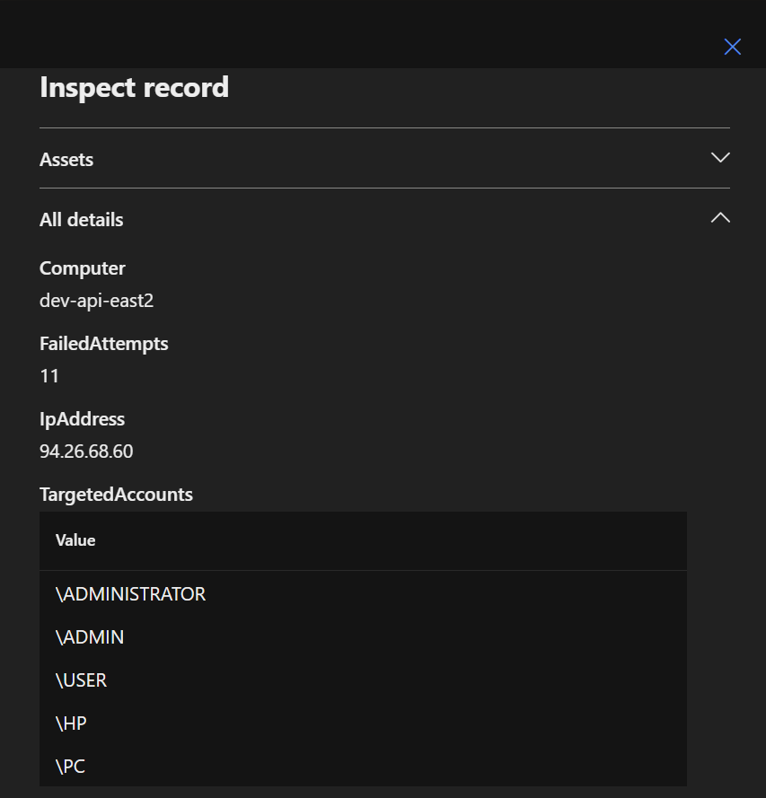

# Azure Sentinel RDP Honeypot Lab

A cloud honeypot built in Microsoft Azure to attract real-world RDP brute-force attacks, collect Windows security telemetry in Microsoft Sentinel, detect the attacks with a custom analytics rule, and map attacker origins with Geo-IP enrichment.

> **Author:** Glenn Fuentes, Cybersecurity student, Florida International University
> **Dates:** November 19–21, 2026 (documentation recaptured November 26, 2026)
> **Status:** Complete. VM deallocated after data collection.

---

## Project Overview

I deployed an intentionally exposed Windows 10 virtual machine in Azure. Its Network Security Group allowed all inbound traffic (any port, any protocol), and I focused on RDP (TCP 3389) brute-force attempts. Its Windows Security logs were forwarded to a Log Analytics workspace connected to Microsoft Sentinel. Within hours of the VM becoming reachable, automated scanners found it and launched dictionary-style login attacks.

The goals were to:

1. Confirm a working log pipeline from endpoint → Log Analytics → Sentinel.
2. Write KQL to find and summarize failed logons (Windows Event ID 4625).
3. Build a scheduled analytics rule that creates incidents for brute-force behavior.
4. Enrich attacker IPs with geolocation and visualize them on an attack map.

## Architecture

| Resource | Name | Role |
|---|---|---|
| Resource group | `RG-SOC-Lab` | Container for all lab resources |
| Virtual machine | `dev-api-east2` (Windows 10, Standard F2as v7) | Exposed honeypot |
| Log Analytics workspace | `law-soc-lab-0000` | Log storage and KQL queries |
| SIEM | Microsoft Sentinel / Microsoft Defender portal | Detection, incidents, workbooks |

The NSG rule `DANGER_AllowAnyCustomAnyInbound` (priority 100) opened every port. Azure itself flagged RDP, SSH, and several database ports as exposed. See [`setup/setup-and-verification.md`](setup/setup-and-verification.md) for the evidence.

The hostname `dev-api-east2` was chosen to look like a real development server rather than an obvious honeypot.

## Technologies

- Microsoft Azure (VMs, Network Security Groups)
- Log Analytics and **KQL** (Kusto Query Language)
- Microsoft Sentinel (analytics rules, incidents, watchlists, workbooks)
- Microsoft Defender portal (unified incident queue)
- Windows Security auditing (Event IDs 4625, 4624, 4672, 4688, 4798, 4799, 4907)
- PowerShell (`Test-NetConnection`)

## Detection Rule

| Setting | Value |
|---|---|
| Name | RDP Brute-Force Attempt Detected (Event 4625) |
| Type | Scheduled analytics rule |
| MITRE ATT&CK | Credential Access, **T1110 Brute Force** |
| Logic | Failed logons from external IPs, grouped by source IP and host, alert when `FailedAttempts >= 5` |
| Schedule | Every 15 minutes, looking back 15 minutes |
| Severity | Medium |

Query: [`queries/rdp-bruteforce-detection.kql`](queries/rdp-bruteforce-detection.kql). Full write-up: [`detections/rdp-bruteforce-rule.md`](detections/rdp-bruteforce-rule.md).

## Key Results

### Pipeline verification
- `Test-NetConnection` to port 3389 returned `TcpTestSucceeded : True`, confirming the NSG and guest firewall allowed external RDP.
- Two deliberate failed logins (`testuser`, `employee`) appeared in `SecurityEvent` within **1–2 minutes**, confirming end-to-end ingestion.
- A 7-hour summary showed **19 distinct Event IDs** being logged, which ruled out a pipeline stall during quiet periods.

### Attack activity
- **1,276** external failed logon (4625) events from **7 attacker IPs**.
- **10 incidents** generated by the analytics rule on Nov 21, 2026, across 7 rule runs between 10:21 AM and 2:37 PM EST.
- Dictionary-based username spraying against common and default account names:
  `ADMINISTRATOR`, `ADMIN`, `ADMINISTRADOR`, `SYSTEM`, `BACKUP`, `USER`, `HP`, `PC`, `GUEST`.
- The noisiest single source, `80.94.95.83`, made **1,181** failed attempts in about 50 minutes.
- `66.51.112.189` used **password spraying**: 39 attempts against 39 different usernames.
- **No successful compromise.** No IP that failed to log on ever produced a successful logon (Event 4624). See [`queries/compromise-check.kql`](queries/compromise-check.kql).

### Attacker geography (Geo-IP attack map)

Final counts from the attack-map workbook:

| Location | Failed logons | Source IP |
|---|---|---|
| Maarn, Netherlands | 1,181 | `80.94.95.83` |
| Milan, Italy | 52 | `94.26.68.60` |
| Murrells Inlet, United States | 39 | `66.51.112.189` |
| Taipei (Taiwan), Tokyo (Japan), Ottawa (Canada), Barrigada Village (Guam), Miami Beach (US), Chicago (US), unnamed US city | 1 each | single probes |

For this screenshot I temporarily filtered out my own pipeline-test logins (`Account !startswith "MicrosoftAccount"`), so only attacker traffic appears.

For comparison, here's the map mid-attack. Maarn was at 901 and still climbing:

Geolocation shows where an IP is registered or hosted. It does not show where the attacker is. Most of this traffic likely came from rented cloud or VPS infrastructure.

Geolocation comes from a Sentinel watchlist (`geoip`, about 55K IP ranges, keyed on `network`) joined to failed logons with KQL's `ipv4_lookup`. Query: [`queries/geoip-attack-map.kql`](queries/geoip-attack-map.kql)

The map is a snapshot taken during the attack, so its counts are lower than the final totals. Two entries were my own test logins and are left out of the table above.

Geolocation shows where an IP is registered or hosted. It does not show where the attacker is. Most of this traffic likely came from rented cloud or VPS infrastructure.

### Example incidents

| Source IP | Failed attempts | Accounts targeted |
|---|---|---|
| `80.94.95.83` | 412 (in one 15-minute window) | ADMINISTRATOR, SYSTEM, ADMIN, USER, BACKUP, ADMINISTRADOR |
| `94.26.68.60` | 11 (in one 15-minute window) | ADMINISTRATOR, ADMIN, USER, HP, PC |

Full timeline: [`investigations/rdp-bruteforce-wave.md`](investigations/rdp-bruteforce-wave.md).

## SOC Skills Demonstrated

- Deploying and exposing a monitored endpoint in the cloud
- Validating a log pipeline before trusting "no alerts" as "no activity"
- Writing KQL to filter, aggregate, and enrich security events
- Building a threshold-based detection mapped to MITRE ATT&CK
- Triaging incidents end to end: investigating, classifying as true positive, documenting a resolution comment, and closing all 10
- Troubleshooting portal behavior (hidden incidents caused by default filters)
- Managing cloud cost (deallocating compute after collection)

## Key Lessons Learned

1. **A quiet SIEM is not proof of no attacks.** I verified reachability and ingestion first.
2. **Attacks come fast and automated.** Internet-wide scanners found an open RDP port within hours.
3. **Default UI filters can hide data.** Sentinel incidents seemed to be missing in the Defender portal until I cleared the `Priority score: 15-100` filter and switched from *Cases* to *Incidents*.
4. **Attackers go after default names.** Nearly every attempt targeted generic admin and system accounts. Renaming or disabling those accounts and using strong, unique credentials defeats this kind of attack.
5. **Screenshot as you go.** I captured results but not every configuration step. See [Project Limitations](#project-limitations).

More: [`documentation/lessons-learned.md`](documentation/lessons-learned.md)

## Repository Guide

| Path | Contents |
|---|---|
| `setup/` | Resource inventory, network exposure, and pipeline verification |
| `detections/` | Analytics rule design and tuning notes |
| `queries/` | KQL used for detection, verification, and the attack map |
| `investigations/` | Timeline and analysis of the brute-force wave |
| `documentation/` | Lessons learned and mitigations |
| `screenshots/` | Evidence images |

## Screenshot Index

| # | Screenshot | Captured |
|---|---|---|
| 01–03 | NSG allow-any rule and Azure exposure warnings | Nov 26 (recaptured) |
| 04–06 | Analytics rule: list, query, and schedule | Nov 26 (recaptured) |
| 07–08 | Incident records for `80.94.95.83` and `94.26.68.60` | **Nov 21 (during attack)** |
| 09 | Incident queue (10 incidents) | Nov 26 (recaptured) |
| 10 | Compromise check: 0 successful logons | Nov 26 |
| 11–12 | Attacker summary by IP | Nov 26 |
| 13 | GeoIP watchlist | Nov 26 (recaptured) |
| 14 | Attack map, mid-attack | **Nov 21 (during attack)** |
| 15 | Attack map, final totals | Nov 26 |
| 16–18 | Incident triage and all incidents resolved | Nov 26 |

## Project Limitations

- Short collection window (about 2 days) with one VM. All ports were open, but only RDP failed logons (4625) were analyzed.
- Not every configuration step was screenshotted at the time. Most screenshots were recaptured on Nov 26, 2026 from retained logs and saved configuration (see the screenshot index).
- The attack-map query (from the tutorial) doesn't filter out test logins or local IPs, so its counts can differ slightly from the attacker-summary query.
- Geo-IP results depend on the lookup dataset's accuracy.

## Future Improvements

- Add entity mapping (IP, Host, Account) to the analytics rule. The incidents currently show "No entities," which makes investigation and correlation harder
- Add a Sentinel automation rule or playbook to enrich or auto-tag incidents
- Detect successful logons (4624) from IPs that previously failed (possible compromise)
- Add a Linux SSH honeypot for comparison
- Compare attacker IPs against threat-intel feeds (AbuseIPDB, VirusTotal)
- Rebuild with infrastructure-as-code (Bicep or Terraform) so the lab is reproducible

## Credits

The lab environment, the GeoIP watchlist, and the attack-map workbook query are based on Josh Madakor's tutorial, [*Cyber Home Lab from ZERO and Catch Attackers! Free, Easy, and REAL (Microsoft Sentinel 2025)*](https://youtu.be/g5JL2RIbThM).

Work I added beyond the tutorial:
- The custom analytics rule (`RDP Brute-Force Attempt Detected (Event 4625)`), mapped to MITRE T1110
- Pipeline verification during quiet periods (reachability test, deliberate failed logons, event-volume check)
- The attacker-summary and compromise-check (Event 4624) hunting queries
- Incident review, identifying brute-force vs. password-spraying patterns, and this write-up

## Authorization and Ethics

All resources were deployed in my own Azure subscription. No attacks were launched against third parties. The only test logins were my own, against my own VM. Screenshots were reviewed before publishing, and my VM's public IP and subscription identifiers have been redacted. Attacker IPs are shown because they are public internet scanners observed hitting the honeypot.

## Project Status

- [x] Deploy and expose honeypot VM
- [x] Verify log ingestion end to end
- [x] Build and test analytics rule
- [x] Geo-IP enrichment and attack map
- [x] Triage and resolve all 10 incidents
- [x] Deallocate VM to stop compute charges
- [ ] Delete remaining lab resources (disk, workspace) when documentation is final
