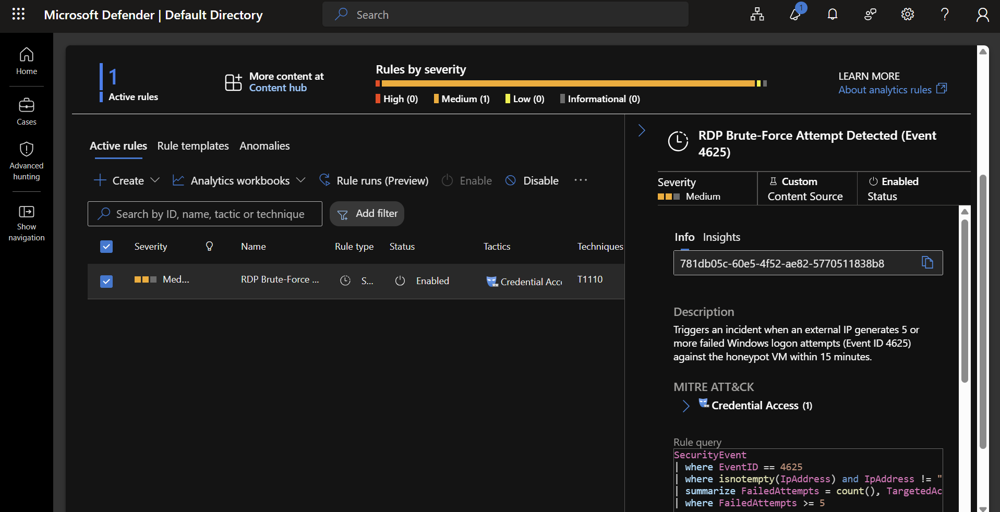
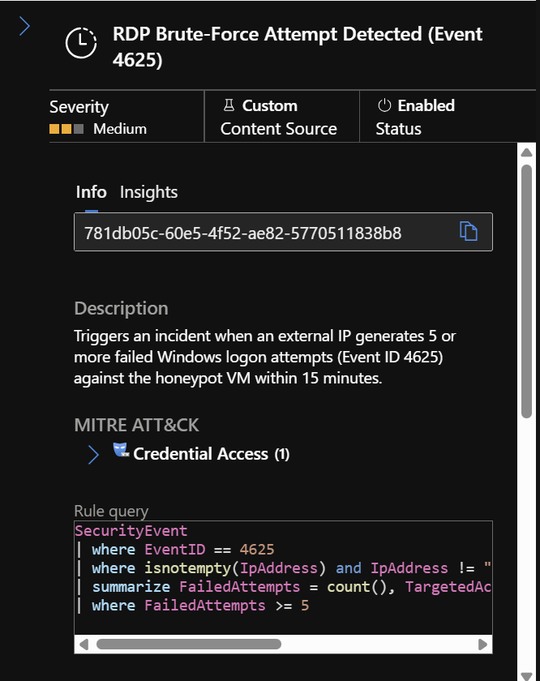
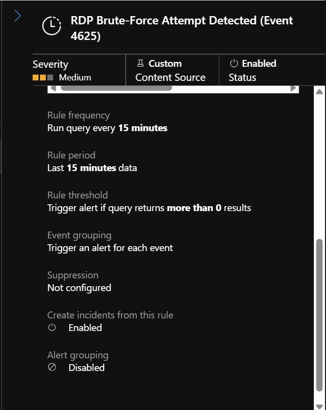
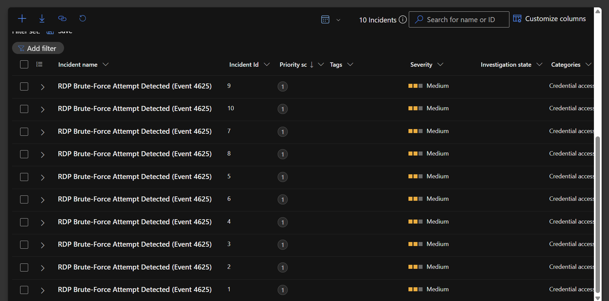

# Detection: RDP Brute-Force Attempt Detected (Event 4625)

| Field | Value |
|---|---|
| Rule type | Sentinel scheduled analytics rule |
| Data source | `SecurityEvent` (Windows Security log) |
| Tactic / Technique | Credential Access / T1110 Brute Force |
| Threshold | `FailedAttempts >= 5` per source IP per host |
| Severity | Medium |
| Schedule | Runs every 15 minutes over the last 15 minutes of data |
| Alert trigger | Query returns more than 0 results |
| Event grouping | One alert per result (each IP/host pair) |
| Suppression | Not configured |
| Incident creation | Enabled (alert grouping disabled) |

**Description (from the rule):** Triggers an incident when an external IP generates 5 or more failed Windows logon attempts (Event ID 4625) against the honeypot VM within 15 minutes.

The query filters out empty, `-`, and `127.0.0.1` source IPs, so local and system logon failures don't create noise.

## Why Event ID 4625
4625 = "An account failed to log on." Many failures from one IP in a short window, especially against many different usernames, is the classic signature of brute-force or password-spraying attacks.

## Query
See [`../queries/rdp-bruteforce-detection.kql`](../queries/rdp-bruteforce-detection.kql).

## Evidence

*Screenshots recaptured Nov 26, 2026 from the saved rule configuration.*

## Results
The rule generated **10 incidents** (IDs 1–10) on Nov 21, 2026. Each one is a single source IP that crossed the threshold in a 15-minute window. Because event grouping is "one alert per result," a run where two IPs crossed the threshold produced two incidents.

| Incident IDs | Created (EST) |
|---|---|
| 1 | 10:21 AM |
| 2 | 10:36 AM |
| 3 | 10:51 AM |
| 4 | 1:51 PM |
| 5, 6 | 2:06 PM, 2:07 PM |
| 7, 8 | 2:22 PM |
| 9, 10 | 2:37 PM |

All incidents were Medium severity, categorized as Credential access, with Microsoft Sentinel as the detection source.

## Tuning notes
- The threshold of 5 fires readily on an internet-exposed honeypot. In a real environment you'd tune it, add a time window, and suppress known-good IPs.
- Possible follow-up rule: a **4624 success from an IP that previously produced 4625 failures**, which would indicate a possible compromise and is much higher priority.

## Portal gotcha
Incidents appeared to be missing in the Defender portal. Two things caused this:
1. Viewing **Cases** instead of **Incidents**
2. The default filter **Priority score: 15–100**

Clearing or resetting the filters brought all 10 incidents back.
