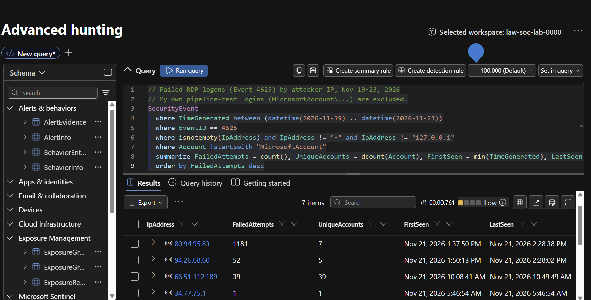
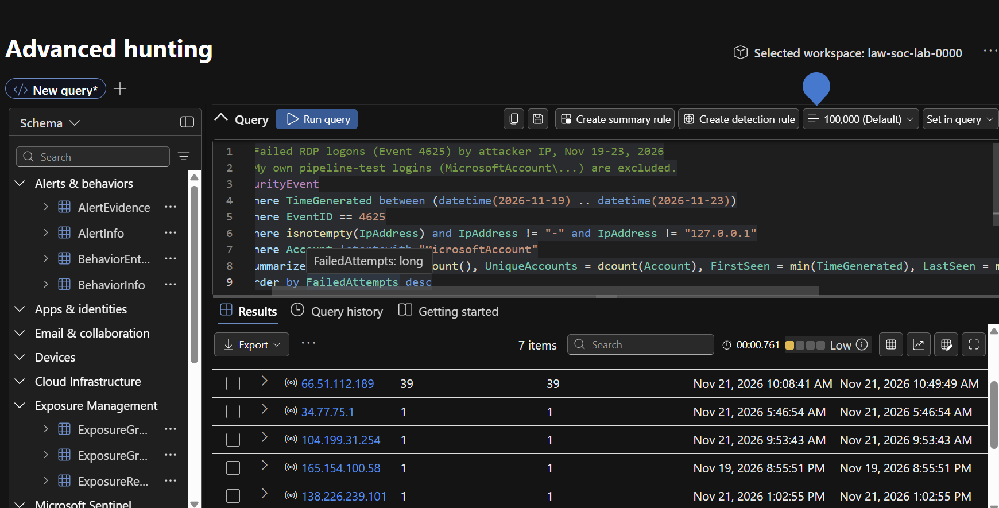
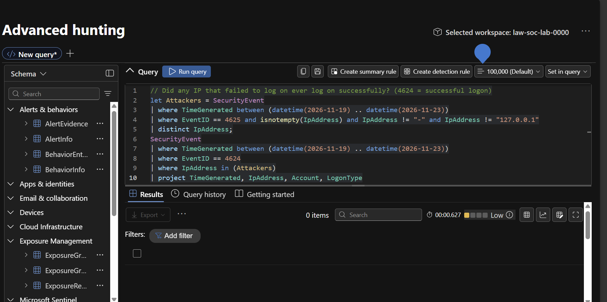
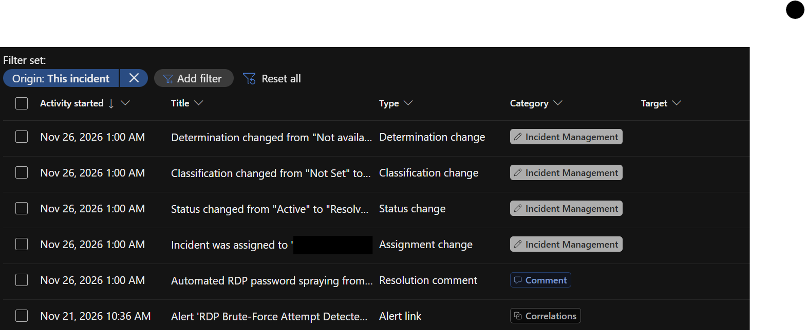
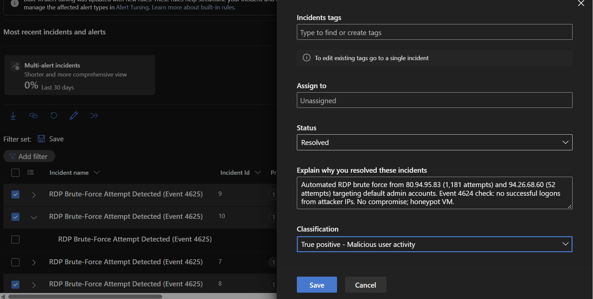
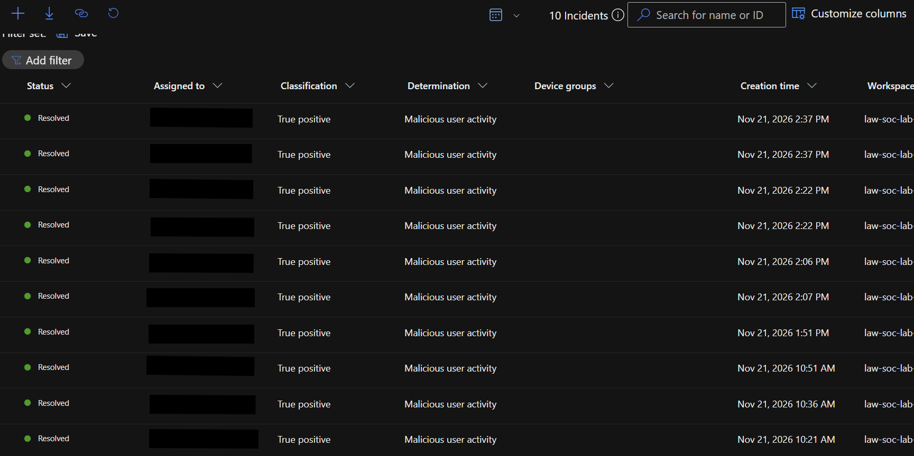

# Investigation: RDP Brute-Force Wave (Nov 19–21, 2026)

All times are EST (UTC−5), as shown in the Defender portal.

## Attacker summary (Event 4625, Nov 19–23)

| Source IP | Failed attempts | Unique accounts tried | First seen | Last seen | Pattern |
|---|---|---|---|---|---|
| `80.94.95.83` | 1,181 | 7 | Nov 21, 1:37 PM | Nov 21, 2:28 PM | High-volume brute force against a few admin names |
| `94.26.68.60` | 52 | 5 | Nov 21, 1:50 PM | Nov 21, 2:28 PM | Brute force, overlapping with 80.94.95.83 |
| `66.51.112.189` | 39 | 39 | Nov 21, 10:08 AM | Nov 21, 10:49 AM | **Password spraying**: one attempt per account |
| `34.77.75.1` | 1 | 1 | Nov 21, 5:46 AM | n/a | Single probe |
| `104.199.31.254` | 1 | 1 | Nov 21, 9:53 AM | n/a | Single probe |
| `138.226.239.101` | 1 | 1 | Nov 21, 1:02 PM | n/a | Single probe |
| `165.154.100.58` | 1 | 1 | Nov 19, 8:55 PM | n/a | First external hit (`\guest`) |

**Total:** 1,276 external failed logons from 7 IPs. Two more failed logons were my own pipeline test and are excluded.

Query: [`../queries/attacker-summary.kql`](../queries/attacker-summary.kql)

## Timeline

| Time (EST) | Event |
|---|---|
| Nov 19, 8:55:51 PM | First external 4625: `\guest` from `165.154.100.58` |
| ~10:01 PM | VM restarted, followed by a few quiet hours |
| Nov 21, 1:14–1:15 AM | My connectivity test plus two deliberate failed logins (`testuser`, `employee`), ingested within 1–2 min |
| Nov 21, 5:46 AM – 9:53 AM | Isolated single probes from cloud-hosted IPs |
| Nov 21, 10:08–10:49 AM | `66.51.112.189` sprays 39 different usernames. Incidents 1–3 created |
| Nov 21, 1:37–2:28 PM | `80.94.95.83` (1,181 attempts) and `94.26.68.60` (52) brute-force at the same time. Incidents 4–10 created |

## What the attackers did
- **Two techniques seen:**
  - **Brute force (T1110.001):** many guesses against a few accounts (`80.94.95.83`, `94.26.68.60`)
  - **Password spraying (T1110.003):** one guess each against many accounts (`66.51.112.189`, 39 attempts across 39 usernames)
- **Usernames tried** included `ADMINISTRATOR`, `ADMIN`, `ADMINISTRADOR` (Spanish/Portuguese), `SYSTEM`, `BACKUP`, `USER`, `HP`, `PC`, and `GUEST`. These are default, vendor, and generic names, so the attackers had no knowledge of the VM's real accounts.
- **Coordination:** the two highest-volume IPs were active in the same 50-minute window. They could be one operator, or unrelated bots that found the VM through the same scan data.

## Was the VM compromised?
**No.** I checked for successful logons (Event 4624) from every IP that had produced a failed logon in the same window. The query returned **0 results**.

Query: [`../queries/compromise-check.kql`](../queries/compromise-check.kql)

## Assessment
- **Disposition:** True positive. Malicious, opportunistic brute-force and password-spraying activity with no successful access.
- The traffic pattern matches automated internet-wide scanning, not a targeted attack.

## Incident triage

All 10 incidents were reviewed, assigned, and resolved as **True positive / Malicious user activity**, each with a resolution comment:

| Incidents | Attacker | Resolution comment (summary) |
|---|---|---|
| 1–3 | `66.51.112.189` | Password spraying, 39 attempts across 39 usernames. No successful logons. |
| 4–10 | `80.94.95.83`, `94.26.68.60` | Brute force against default admin accounts (1,181 + 52 attempts). No successful logons. |

## Recommended mitigations (for a real system)
- Don't expose RDP directly to the internet. Use a VPN, Azure Bastion, or Just-in-Time VM access.
- Never use an allow-any NSG rule. Restrict both source IPs and ports.
- Rename or disable the default Administrator and Guest accounts.
- Enforce an account lockout policy, strong passwords, and MFA.
