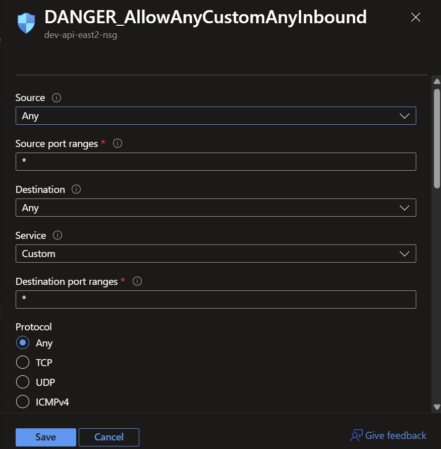
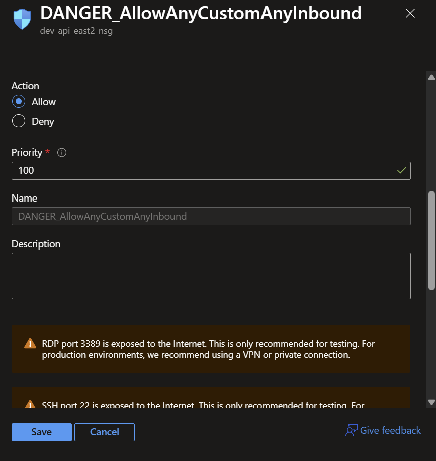
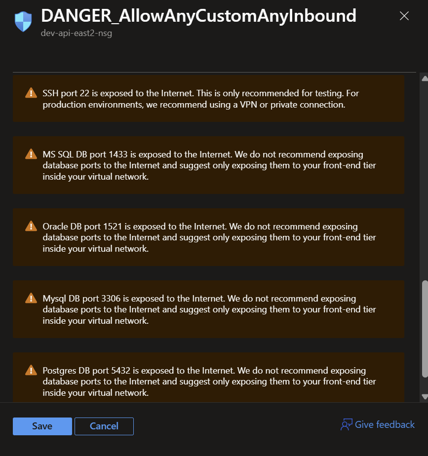

# Setup and Pipeline Verification

## Resource inventory

| Resource | Value |
|---|---|
| Resource group | `RG-SOC-Lab` |
| VM | `dev-api-east2`, Windows 10, `Standard F2as v7` |
| VM public IP | `<REDACTED>` (dynamic, so it can change across deallocate/start cycles) |
| Log Analytics workspace | `law-soc-lab-0000` |
| SIEM | Microsoft Sentinel, viewed through the Microsoft Defender portal (`security.microsoft.com`) |

## Network exposure

- **NSG (`dev-api-east2-nsg`):** custom inbound rule `DANGER_AllowAnyCustomAnyInbound` at priority 100. It allows **any source, any port (`*`), any protocol**, so the VM was exposed to the internet on every port, not just RDP. Azure warns about this directly, flagging RDP 3389, SSH 22, MS SQL 1433, Oracle 1521, MySQL 3306, and Postgres 5432 as exposed.
- **Guest OS:** Windows Firewall configured to allow RDP





*Screenshots recaptured Nov 26, 2026 from the saved NSG configuration.*

> Exposing a VM this widely is intentional for a honeypot. Never do this on a real system. This lab only monitored RDP (Event 4625), so attempts against other ports weren't analyzed.

## Verification steps

### 1. External reachability
After a few quiet hours following a VM restart (~10:01 PM EST), I tested from my own machine:

```powershell
Test-NetConnection -ComputerName <VM_PUBLIC_IP> -Port 3389
```
Result: `TcpTestSucceeded : True`. The NSG and firewall weren't blocking the port.

### 2. End-to-end ingestion
I made two deliberate failed RDP logins:

| Time (Nov 21, EST / UTC) | Account |
|---|---|
| 1:14:24 AM / 06:14:24 | `MicrosoftAccount\testuser` |
| 1:15:09 AM / 06:15:09 | `MicrosoftAccount\employee` |

Both showed up in `SecurityEvent` as Event ID 4625 within about 1–2 minutes.

### 3. Logging health
A 7-hour summary query (see `queries/pipeline-verification.kql`) returned **19 distinct Event IDs**, including 4624, 4672, 4688, 4798, 4799, and 4907. This showed the pipeline was healthy and that the gaps in 4625 events reflected real lulls in attacks.

## Cost hygiene
After collection, the VM was **stopped (deallocated)** from the Azure Portal. An OS-only shutdown still bills for compute. Managed disk and Log Analytics/Sentinel storage can still cost a small amount until those resources are deleted.
